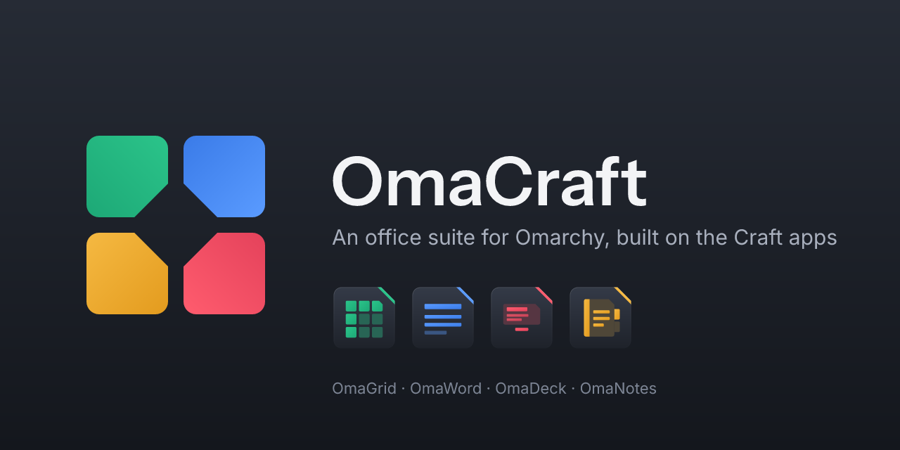

**OmaCraft** is an office suite for [Omarchy](https://omarchy.org). It is native, fast and themed by your desktop, and built in Rust on [storytold](https://github.com/storytold)'s Craft apps.

| | App | For |
|---|---|---|
|  | [**OmaGrid**](https://github.com/OmaCraft/omagrid) | Spreadsheets (xlsx, csv) |
|  | [**OmaWord**](https://github.com/OmaCraft/omaword) | Documents (docx) |
|  | [**OmaDeck**](https://github.com/OmaCraft/omadeck) | Presentations (pptx) |
|  | **OmaNotes** | Notebooks (coming soon) |

- **Follows your desktop.** It uses the Omarchy theme's colours, in light and dark.
- **One suite, one feel.** The four apps share the same title bar, search box and File view.
- **Upstream first.** Each app tracks its Craft upstream and pulls it in on a regular cycle, and OmaCraft adds the suite layer on top.

OmaCraft is in **alpha**. There is no public release yet.
